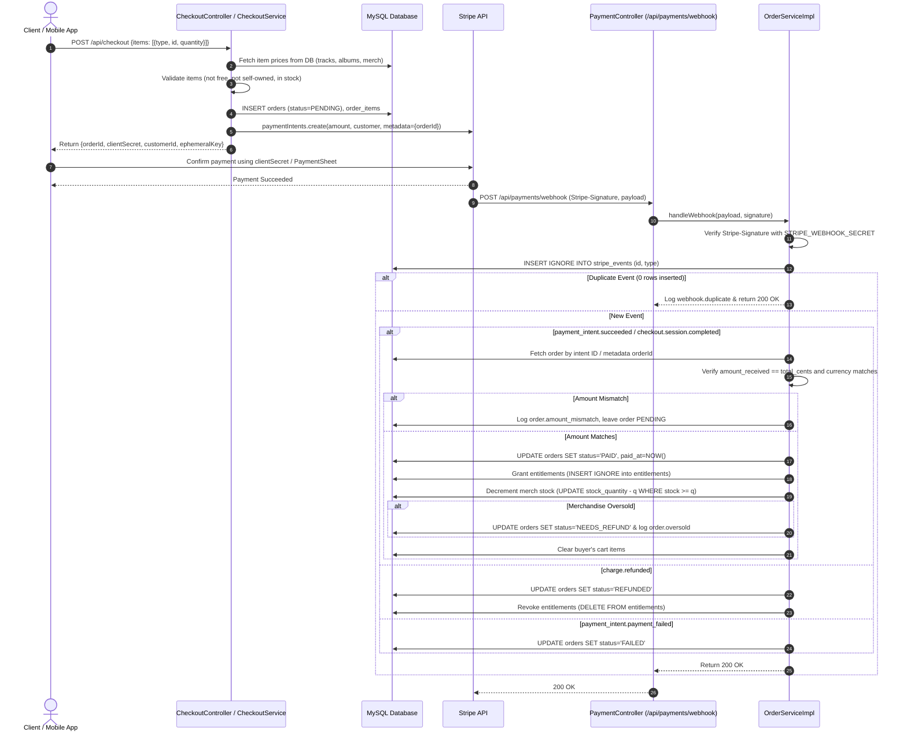

# Payments & Checkout Architecture (Operation Ninja T Frog Phase 5)

## Overview
Phase 5 establishes a secure, server-authoritative checkout and payment processing flow.
Prices are derived exclusively from the database, eliminating client-side price tampering. Orders and entitlements are strictly synchronized using Stripe webhooks with cryptographic signature verification and idempotency controls.

---

## Architecture & Event Flow



---

## Local Testing with Stripe CLI

To test Stripe checkout and webhook events locally:

### 1. Start Webhook Forwarding
Forward webhook events from Stripe to your local running application:
```bash
stripe listen --forward-to localhost:8080/api/payments/webhook
```
When started, the CLI will output a webhook signing secret:
```
> Ready! Your webhook signing secret is whsec_xxxxxxxxxxxxxxxxxxxxxxxxxxxxxxxx
```
Ensure your application has `STRIPE_WEBHOOK_SECRET=whsec_xxxxxxxxxxxxxxxxxxxxxxxxxxxxxxxx` set in its environment or `application.properties`.

### 2. Triggering Webhook Events
In another terminal, trigger test events:
```bash
# Trigger a payment_intent.succeeded event
stripe trigger payment_intent.succeeded

# Trigger a checkout.session.completed event
stripe trigger checkout.session.completed

# Trigger a charge.refunded event
stripe trigger charge.refunded
```

### 3. Simulating Webhooks with Fixtures
To test end-to-end order fulfillment with a real order ID:
```bash
stripe trigger payment_intent.succeeded \
  --override payment_intent:metadata.orderId="1" \
  --override payment_intent:amount=1500 \
  --override payment_intent:currency="usd"
```

---

## Key Endpoints

| Method | Endpoint | Access | Description |
|---|---|---|---|
| `POST` | `/api/checkout` | Authenticated | Create order & PaymentIntent for mobile/in-app checkout |
| `POST` | `/api/checkout/session` | Authenticated | Create order & Stripe Checkout Session for web checkout |
| `POST` | `/api/payments/webhook` | Public | Ingest and process Stripe webhook events |
| `GET` | `/api/orders` | Authenticated | Get current user's order history (paged) |
| `GET` | `/api/orders/{id}` | Authenticated | Get specific order details (owner or admin only) |
| `GET` | `/api/library` | Authenticated | Get user's entitled tracks from paid orders (paged) |
| `GET` | `/api/payments/history` | Authenticated | View legacy payment history |
| `GET` | `/api/payments/saved-cards` | Authenticated | View saved customer payment methods |

---

## Deprecated & Removed Endpoints
The following insecure or mock endpoints have been removed:
- `POST /api/payments`
- `POST /api/payments/buy/track/{trackId}`
- `POST /api/payments/buy/merchandise/{merchandiseId}`
- `POST /api/payments/buy/album/{albumId}`
- `POST /api/payments/checkout-session`
- `POST /api/payments/create-intent`
- `POST /api/payments/confirm-intent`
